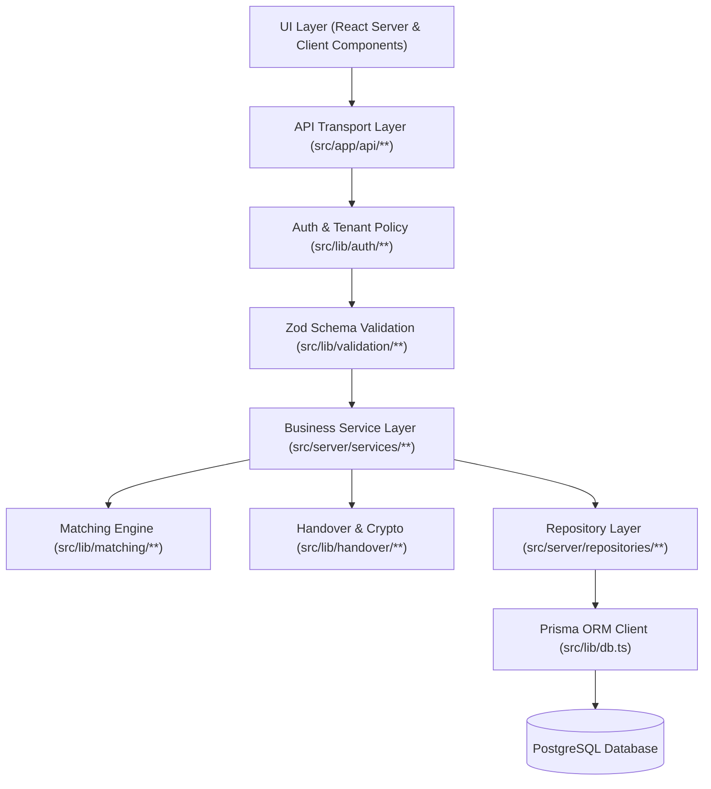

# LostLink 2.0 — Architecture Audit (ARCHITECTURE_AUDIT.md)

**Date:** November 2026  
**Auditor:** Principal Software Architect, Senior Next.js Engineer, Application Security Architect  
**Repository:** `https://github.com/Mayyank04/lostlink`  
**Target:** Master Codebase Architecture, Clean Code & Scalability Upgrade

---

## 1. Executive Summary

LostLink 2.0 is a multi-university campus lost-and-found management platform developed with Next.js 14 (App Router), TypeScript, PostgreSQL, and Prisma ORM.

The platform provides end-to-end functionality including:
- Student registration and university email verification via single-use OTPs.
- Role-based authorization across four tiers: `STUDENT`, `COLLEGE_MODERATOR`, `COLLEGE_ADMIN`, and `PLATFORM_ADMIN`.
- Tenant isolation across universities and campuses via `CollegeMembership` scopes.
- Lost and found item reporting with zero-knowledge private evidence escrow.
- An explainable, rule-based 6-factor deterministic matching engine.
- Ownership verification claims and in-person custody handovers validated via single-use 6-digit OTP tokens.
- Complete Kubernetes / K3s production deployment configurations.

This audit evaluates the codebase across structural modularity, layer separation, error handling, configuration management, duplicate logic, and scalability.

---

## 2. Current Architecture Overview

```
lostlink/
├── prisma/
│   └── schema.prisma         # 15 models, 8 enums, relational foreign keys
├── src/
│   ├── app/
│   │   ├── (pages)            # 18 frontend page routes (dashboard, items, claims, etc.)
│   │   └── api/               # 86 Next.js route handlers
│   ├── components/
│   │   ├── ui/                # Base primitives (Button, Modal, Input, etc.)
│   │   ├── common/            # Shared components (Navbar, Footer, Skeletons)
│   │   ├── items/             # Item cards
│   │   ├── matching/          # Match comparisons and scores
│   │   ├── claims/            # Claim timeline, forms, handover modals
│   │   ├── colleges/          # Searchable college picker, filter modals
│   │   └── platform-admin/    # Super admin sections
│   ├── context/               # AuthContext, ThemeContext, ToastContext
│   ├── lib/
│   │   ├── auth/              # session.ts, tenant.ts, password.ts, rateLimit.ts
│   │   ├── crypto/            # evidenceEncryption.ts
│   │   ├── handover/          # crypto.ts (OTP generation & hashing)
│   │   ├── matching/          # engine.ts (client scoring), matchEngine.ts (DB engine)
│   │   ├── storage/           # localStore.ts, objectStorage.ts
│   │   ├── services/          # api.ts (giant client-side service monolith)
│   │   ├── db.ts              # PrismaClient singleton
│   │   └── utils.ts           # Formatters, category configs
│   ├── types/                 # Domain interface definitions
│   └── tests/                 # 18 Vitest integration test suites (179 tests)
├── k8s/                       # Kubernetes base & Vultr overlay manifests
└── Dockerfile                 # Multi-stage production container build
```

---

## 3. Existing Architectural Strengths

1. **High Quality Test Coverage:**
   - 179 comprehensive tests across 19 test files with a 100% pass rate.
   - Tests thoroughly exercise edge cases in password hashing, token validation, college-bound OTP verification, role escalation prevention, and cross-college tenant isolation.
2. **Robust Multi-Tenant Data Model:**
   - Database schema properly partitions items, claims, memberships, and audit logs by `collegeId` and `campusId`.
   - `UserRole` and `MembershipStatus` enforce distinct privileges for students, campus moderators, college admins, and platform administrators.
3. **Defense-in-Depth Security:**
   - Argon2id password hashing with modern memory/time parameters.
   - Signed HMAC SHA-256 JWT session tokens stored in HTTP-only, SameSite, Secure cookies.
   - In-memory sliding-window rate limiting protecting sensitive auth and OTP routes.
   - Zero-knowledge encryption isolating sensitive evidence (serial snippets, lockscreen photos).
4. **Deterministic & Explainable Matching:**
   - 6-factor similarity engine evaluates Category (25%), Keywords (25%), Color (15%), Brand (10%), Location (15%), and Timeline (10%) without external third-party AI dependencies.
5. **Anti-AI-Slop Design System:**
   - Official `DESIGN.md` establishing academic teal (`#0F766E`), deep slate canvas, strict 4-tier radius tokens, and high-contrast accessible states.

---

## 4. Architectural Deficiencies & Structural Problems

### 4.1 Missing Service and Repository Layers on the Server
- **Problem:** API route handlers in `src/app/api/...` directly contain raw Prisma queries, business rules, transaction orchestration, and notification dispatching.
- **Impact:** Tight coupling between HTTP transport (Next.js request/response parsing) and database logic prevents reuse, complicates unit testing, and risks subtle business logic divergence between routes.
- **Example:** `src/app/api/claims/[id]/route.ts` contains 258 lines mixing authentication, role authorization, claim status transitions, item status updates, notification creation, and audit logging inside an ad-hoc `$transaction`.

### 4.2 Client Service Monolith (`src/lib/services/api.ts`)
- **Problem:** `src/lib/services/api.ts` spans 1,021 lines combining `ReportService`, `MatchingService`, `ClaimService`, `MessageService`, `NotificationService`, `CollegeService`, and `AnalyticsService` into a single file.
- **Impact:** The file mixes network fetch calls with client-side localStorage fallback, database model re-mapping, and mock data injection.

### 4.3 Inconsistent Error Handling & API Response Shapes
- **Problem:** Different API endpoints return different response structures on success and failure:
  - Route A returns `{ success: true, item: {...} }`
  - Route B returns `{ success: true, data: {...} }`
  - Route C returns `{ error: 'Message' }` with status 400
  - Route D returns `{ success: false, error: 'Message' }` with status 400
- **Impact:** Frontend components require defensive ad-hoc checks for response shapes (`if (data.success && data.item) ... else if (data.item) ...`).
- **Absence of Typed Application Errors:** Errors are thrown as raw `Error` or `AuthError` without semantic subclasses like `ValidationError`, `NotFoundError`, `ConflictError`, `RateLimitError`.

### 4.4 Scattered Environment Variable Access
- **Problem:** Direct `process.env` lookups are scattered across more than 20 files without centralized initialization or Zod schema validation.
- **Risk:** Missing configuration variables in deployment fail at runtime during deep nested execution paths rather than failing fast at application boot.

### 4.5 Duplicated Logic Across Matching Engines
- **Problem:** Both `src/lib/matching/engine.ts` (client scoring) and `src/lib/matching/matchEngine.ts` (database matching) implement separate text normalization, tokenization, and similarity functions.
- **Recommendation:** Consolidate core mathematical and token utilities in a shared module (`src/lib/matching/core.ts`) while keeping client evaluation and server database jobs cleanly separated.

### 4.6 Broad `any` Types in State & Data Handlers
- **Problem:** Several admin sections and dashboard loaders declare state as `useState<any[]>([])` or `overviewData: any`.
- **Impact:** Decreases TypeScript compile-time safety and increases risk of runtime `undefined` property access.

---

## 5. Refactoring Priorities & Migration Strategy

### Priority 1: Centralized Configuration & Typed Errors
- Create `src/lib/config/` with Zod validation for all environment variables (`env.ts`, `database.ts`, `auth.ts`, `storage.ts`, `app.ts`).
- Create `src/lib/errors/` with typed application errors (`AppError`, `ValidationError`, `AuthenticationError`, `AuthorizationError`, `NotFoundError`, `ConflictError`, `RateLimitError`, `DatabaseError`).
- Create standardized API response helpers in `src/lib/api/response.ts` (`apiSuccess`, `apiError`) with full backward-compatibility for existing test assertions.

### Priority 2: Establish Server Service & Repository Layers
- Create `src/server/repositories/` with dedicated data access modules:
  - `item.repository.ts`
  - `claim.repository.ts`
  - `college.repository.ts`
  - `user.repository.ts`
  - `handover.repository.ts`
- Create `src/server/services/` with pure business workflows:
  - `item.service.ts`
  - `claim.service.ts`
  - `handover.service.ts`
  - `college.service.ts`
  - `auth.service.ts`
- Refactor key API routes to delegate business logic to services, keeping route handlers clean, predictable, and maintainable.

### Priority 3: Modularize Client Services
- Decompose `src/lib/services/api.ts` into clean domain client services or modular export files (`items.client.ts`, `claims.client.ts`, `colleges.client.ts`, etc.) while maintaining the public API exports so existing components and tests experience zero breaking changes.

### Priority 4: Dead Code & Redundancy Removal
- Audit unused imports, dead functions, and obsolete files.
- Document every cleanup in `DEAD_CODE_AUDIT.md`.

### Priority 5: Strict Types & Reusable Component System
- Refine types across admin sections, eliminating broad `any` where possible.
- Ensure strict adherence to `DESIGN.md` component and layout rules.

### Priority 6: Documentation & Architecture Specifications
- Author comprehensive documentation suite in `docs/`:
  - `docs/architecture/` (overview, folder structure, data flow, auth)
  - `docs/api/` (conventions, error handling, endpoints)
  - `docs/database/` (schema overview, migrations)
  - `docs/development/` (setup, standards, testing, environment)
  - `docs/deployment/` (deployment guide)
- Create repository root `ARCHITECTURE.md` capturing key design decisions.

---

## 6. Target Architecture Diagram


