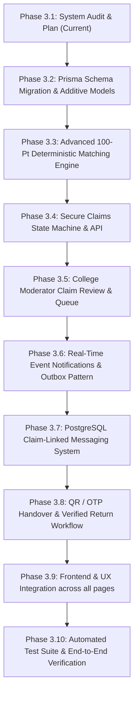

# LostLink 2.0 — Phase 3 Implementation Plan

## Smart Matching Engine, Secure Ownership Claims, Real-Time Notifications, Messaging, Verified Returns & College Moderation

**Document Version:** 1.0  
**Branch:** `phase-3-recovery`  
**Date:** 2026-11-01  

---

### 1. Audit of Current Functionality vs Missing Requirements

| Capability | Current Status (Phase 2) | Phase 3 Target State |
|---|---|---|
| **Database & ORM** | PostgreSQL 16 + Prisma with 15 models (College, Campus, User, Item, Claim, Match, etc.) | Extend schema with `Conversation`, `ConversationParticipant`, `Message`, `MessageReport`, `HandoverChallenge`, `ClaimStatusHistory`, and `OutboxEvent`. Update `ClaimStatus` enum. |
| **Matching Algorithm** | Basic overlap scoring in `matchEngine.ts` | Complete 100-point deterministic model: Category (25), Title/Keyword Aliases (25), Color (15), Brand (10), Location (15), Chronology (10). Configurable constants. Reusable worker-ready service. |
| **Match Persistence** | Upserts in `Match` table with `status="SUGGESTED"` | Multi-state matches (`ACTIVE`, `DISMISSED`, `CLAIMED`, `RESOLVED`, `EXPIRED`). Deduplication, rule versioning, recalculation API. |
| **Matches UI** | `/matches` with mock fallback in `api.ts` | Real database-backed `/matches` page, side-by-side comparison, request ownership action, dismiss action, pagination. |
| **Ownership Claims** | Basic `Claim` model and create/review | Server-controlled finite state machine (`PENDING`, `UNDER_REVIEW`, `APPROVED`, `REJECTED`, `HANDOVER_PENDING`, `RETURNED`, `CANCELLED`, `DISPUTED`). Anti-self-claim, competing claimants support, private evidence protection. |
| **College Moderation** | Basic `GET /api/admin/reports` and membership review | Dedicated claims moderation queue (`/api/admin/claims`), evidence inspection, approve/reject/dispute with reason codes, audit trail. |
| **Messaging System** | Client-side `localStore` only | Real PostgreSQL-backed conversations, participant access control, rate-limited message creation, unread tracking, abuse reporting (`/api/conversations/*`). |
| **Notifications** | Basic `/api/notifications` | Real event-triggered notifications for matches, claims, messages, handovers. Outbox persistence model and email abstraction. |
| **Handover & Return** | Static 6-digit mockup in modal | Cryptographic one-time handover challenge (hashed OTP & QR token verifier), atomic transition to `RETURNED`, dual confirmation, moderator override fallback. |
| **Dashboard Metrics** | Basic stats endpoint | Real-time counts reflecting active matches, pending claims, unread messages, unread notifications, and verified returned items. |

---

### 2. Required Database Schema Changes

1. **Enum `ClaimStatus` Update:**
   - Add: `HANDOVER_PENDING`, `CANCELLED`, `DISPUTED`, `RETURNED`
2. **Model `HandoverChallenge`:**
   - `id`, `claimId`, `itemId`, `codeHash`, `qrTokenHash`, `expiresAt`, `status` (`PENDING`, `CONFIRMED`, `EXPIRED`, `CANCELLED`), `verificationMethod` (`QR`, `OTP`, `MANUAL_MODERATOR`), `confirmedByUserId`, `confirmedAt`, `createdAt`
3. **Model `ClaimStatusHistory`:**
   - `id`, `claimId`, `fromStatus`, `toStatus`, `actorId`, `notes`, `reasonCode`, `createdAt`
4. **Messaging Models:**
   - `Conversation` (`id`, `claimId?`, `itemId?`, `title?`, `createdAt`, `updatedAt`)
   - `ConversationParticipant` (`id`, `conversationId`, `userId`, `joinedAt`, `lastReadAt`)
   - `Message` (`id`, `conversationId`, `senderId`, `content`, `createdAt`)
   - `MessageReport` (`id`, `messageId`, `reporterId`, `reason`, `status`, `createdAt`)
5. **Model `NotificationPreference`:**
   - `id`, `userId`, `emailMatches`, `emailClaims`, `emailMessages`, `emailHandovers`
6. **Model `OutboxEvent`:**
   - `id`, `eventType`, `payload`, `status` (`PENDING`, `PROCESSED`, `FAILED`), `attempts`, `error`, `createdAt`, `processedAt`

---

### 3. Proposed Implementation Order

---

### 4. Security & Privacy Considerations

- **Ownership Evidence Isolation:** Confidential proof (serial numbers, engraving text, lockscreen details) is strictly hidden from public APIs, matching explanations, and competing claimants.
- **Object-Level Authorization:** On every request, the server inspects the caller's session, college membership, and object ownership.
- **Handover Challenge Protection:** Handover OTPs and QR tokens are stored as cryptographic hashes (`sha256`), single-use, timed to expire, and rate-limited against brute-force attacks.
- **Spam & Abuse Guards:** Rate limiting on claims, messages, and match recalculations. Message reporting workflows for moderators.

---

### 5. Testing Requirements

- Unit tests for matching engine weights, aliases, and edge cases.
- Claim state machine transition and authorization tests.
- Messaging participant isolation and abuse reporting tests.
- Handover token hashing, expiration, and replay prevention tests.
- Full end-to-end recovery lifecycle automated test.
