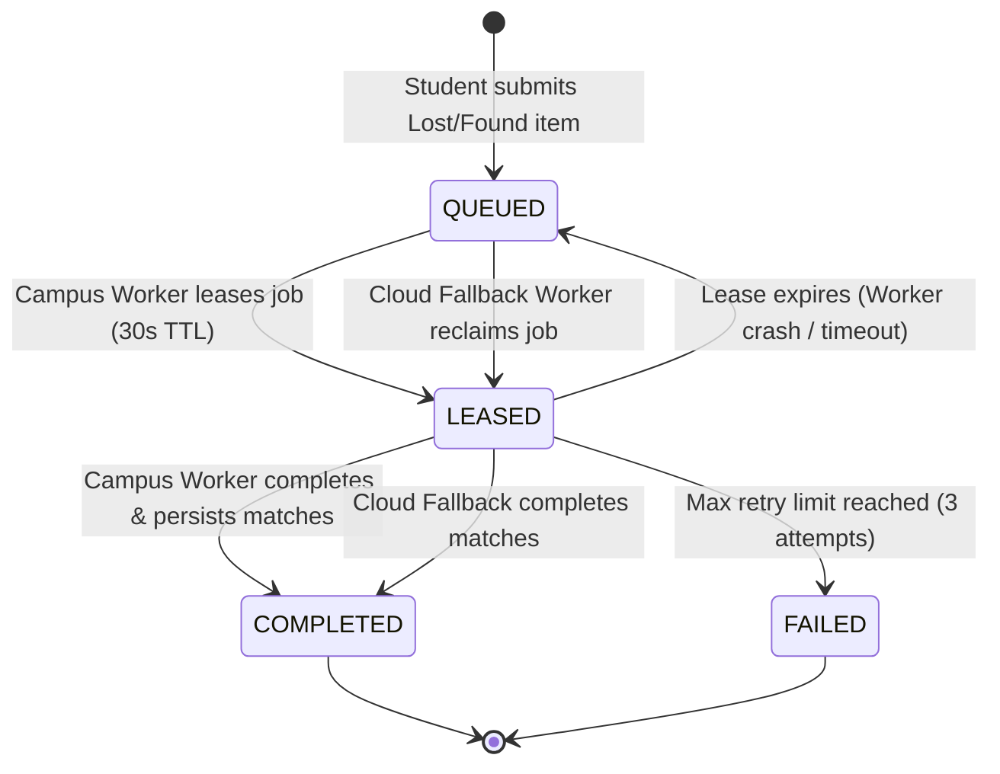

# LostLink 2.0 — Hybrid-Cloud Distributed Architecture

## 1. Executive Architecture Overview

LostLink 2.0 implements a **Hybrid-Cloud Edge-Assisted Architecture** designed specifically for universities and colleges.

The platform partitions compute and data storage across two distinct infrastructure tiers:
1. **Environment A (Public Cloud VPS)**: Hosts the centralized student-facing web application, PostgreSQL database, authentication services, storage driver, and cloud fallback workers.
2. **Environment B (Private College Edge Node)**: Hosts college-specific matching agents running on physical college hardware or on-premises VMs located behind university campus firewalls and proxies.

```
+---------------------------------------------------------------------------------------------------+
|                                  LOSTLINK 2.0 HYBRID TOPOLOGY                                     |
+---------------------------------------------------------------------------------------------------+
|                                                                                                   |
|  [ PUBLIC CLOUD ENVIRONMENT A ]                                   [ PRIVATE COLLEGE CAMPUS B ]   |
|  (Hetzner / DigitalOcean VPS)                                     (Apex Institute On-Premises)    |
|                                                                                                   |
|  +---------------------------+                                                                    |
|  | Student Browser / Mobile  |                                                                    |
|  +-------------+-------------+                                                                    |
|                | HTTPS 443                                                                        |
|                v                                                                                  |
|  +---------------------------+                                                                    |
|  | Traefik Ingress Controller|                                                                    |
|  +-------------+-------------+                                                                    |
|                |                                                                                  |
|                v                                                                                  |
|  +---------------------------+       HTTPS Outbound REST (Port 443)      +---------------------+  |
|  | Next.js App Router (Web)  | <======================================== | Campus Edge Agent   |  |
|  | /api/hybrid/jobs/lease    |   (No Inbound Campus Ports Opened)        | (Node.js/Container) |  |
|  | /api/hybrid/jobs/complete |                                           | Runs Matching Rules |  |
|  +-------------+-------------+                                           +----------+----------+  |
|                |                                                                    |             |
|                |                                                                    | Healthz     |
|                v                                                                    v (Port 3002) |
|  +---------------------------+     +--------------------------+          +---------------------+  |
|  | PostgreSQL Database       | <-- | Cloud Fallback Watchdog  |          | Local Campus Health |  |
|  | MatchingJob Queue (TTL)   |     | (Reclaims Orphaned Jobs) |          | (Local Loopback)    |  |
|  +---------------------------+     +--------------------------+          +---------------------+  |
|                                                                                                   |
+---------------------------------------------------------------------------------------------------+
```

---

## 2. Zero-Inbound-Port Hybrid Communication Model

Campus network administrators typically forbid opening public inbound firewall ports into university internal networks. 

LostLink 2.0 resolves this restriction with an **Outbound-Only Pull Architecture**:
- **Zero Inbound Holes**: The college edge agent requires **NO inbound ports** on the university firewall, no port-forwarding, and no static public IP.
- **Outbound HTTPS REST**: The agent initiates all network connections outbound to the public cloud URL over standard TLS (port 443).
- **Long-Polling Protocol**:
  1. The agent polls `POST /api/hybrid/jobs/lease` every 3 seconds with its cryptographically hashed machine bearer token.
  2. If a matching job exists for its registered college, the public cloud atomically locks the job with a 30-second lease Time-To-Live (TTL) and returns the sanitized payload.
  3. The edge agent executes the deterministic matching algorithm locally on college compute.
  4. The edge agent returns candidate matches and execution metrics via `POST /api/hybrid/jobs/[id]/complete`.
  5. The edge agent sends periodic telemetry via `POST /api/hybrid/heartbeat`.

---

## 3. Data Minimization & Student Privacy Boundary

University privacy regulations (FERPA, GDPR, India DPDP Act) require strict protection of student personally identifiable information (PII).

LostLink 2.0 enforces a **Zero-Knowledge Evidence Boundary**:
- **What is transmitted to the Campus Edge Worker**:
  - Non-sensitive item classification: `title`, `description`, `category`, `color`, `brand`, `locationBuilding`, `occurredAt`.
- **What is NEVER transmitted to the Campus Edge Worker**:
  - ❌ Student reporter names
  - ❌ Student email addresses and phone numbers
  - ❌ Student user IDs
  - ❌ Private ownership evidence (serial numbers, hidden markings, purchase receipts, unlock passwords)
  - ❌ Claim notes and messaging conversations

All sensitive student data and private verification evidence remain strictly confined inside the encrypted cloud database.

---

## 4. Distributed Job Lifecycle & State Machine

Every item report triggers a `MatchingJob` managed by a state machine:



### Job States:
- **`QUEUED`**: Newly generated job awaiting processing.
- **`LEASED`**: Atomically claimed by an authorized worker; protected by a 30-second TTL lease.
- **`RUNNING`**: Worker actively computing similarity scores.
- **`COMPLETED`**: Match results persisted and notifications delivered to students.
- **`RETRY_PENDING`**: Transient failure occurred; eligible for retry.
- **`FAILED`**: Max attempts (3) exceeded; operator inspection required.
- **`CANCELLED`**: Job superseded or cancelled by user.

---

## 5. Split-Brain & Concurrency Defense

In distributed hybrid environments, network partitions can cause a campus worker to appear dead while still executing work. If the cloud fallback worker takes over, both workers might try to submit results for the same job.

LostLink 2.0 eliminates split-brain conditions through **Atomic Optimistic Concurrency**:
1. **Atomic Lease Grant**:
   ```sql
   UPDATE "MatchingJob"
   SET "status" = 'LEASED', "assignedWorkerId" = $workerId, "leaseExpiresAt" = $expiresAt
   WHERE "id" = $jobId AND ("status" = 'QUEUED' OR ("status" = 'LEASED' AND "leaseExpiresAt" < NOW()));
   ```
2. **Double-Completion Lock**:
   When a worker submits results, the public cloud executes an atomic transaction that verifies `status === 'LEASED'` and `assignedWorkerId === workerId`.
   If the job has already been marked `COMPLETED` by the fallback worker, the delayed campus worker's submission is **immediately rejected with HTTP 409 Conflict**.
3. **Zero Duplicate Matches**:
   Because completions are atomic transactions, duplicate `Match` records cannot be generated under any network partition condition.

