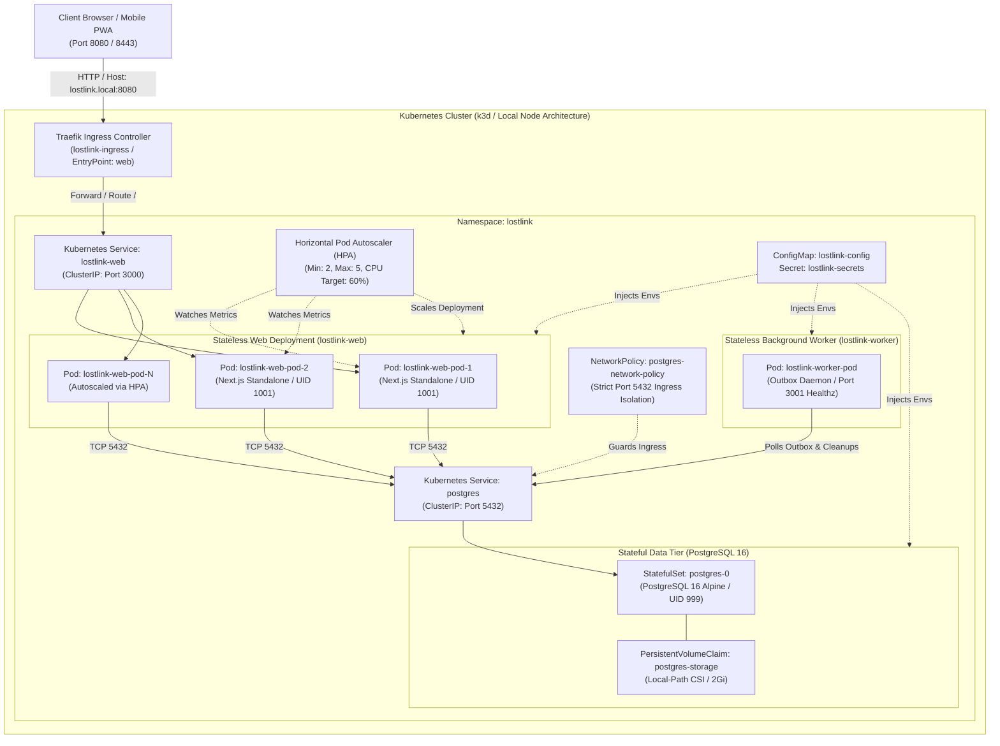

# LostLink 2.0 — Phase 4 Infrastructure Architecture & Specification

## 1. Executive Summary & PBL Context

LostLink 2.0 is an enterprise multi-college lost-and-found recovery ecosystem designed for real-world deployment across university institutions. Built for the **Cloud Computing Module IV Project-Based Learning (PBL)** assignment (*"Design a scalable web app using containers/Kubernetes, deploy on hybrid cloud, and optimize costs"*), Phase 4 transforms LostLink from a full-stack Next.js application into a containerized, Kubernetes-orchestrated, resilient cloud-native platform.

The infrastructure satisfies four core production engineering principles:
1. **Decoupled Workloads:** Interactive HTTP traffic and background outbox/event processing are segregated into separate scalable micro-tiers (`lostlink-web` and `lostlink-worker`).
2. **Deterministic State Management:** Database persistence is managed via Kubernetes `StatefulSet` with dedicated `PersistentVolumeClaim` (PVC) storage, decoupled from ephemeral stateless application pods.
3. **Defense-in-Depth Security:** Enforced non-root user execution (`UID 1001`), immutable ServiceAccounts, least-privilege RBAC, and granular Kubernetes `NetworkPolicy` firewalls preventing unauthorized direct database ingress.
4. **Elastic Scaling & Observability:** Real-time metrics streaming through `metrics-server`, dynamic Horizontal Pod Autoscaling (HPA) targeting 60% CPU utilization, and zero-downtime rolling updates with sub-second health checks (`/api/health/live` and `/api/health/ready`).

---

## 2. Cloud-Native System Topology

The diagram below outlines the end-to-end traffic flow, networking boundaries, storage mounts, and inter-service communications inside the Kubernetes cluster:

---

## 3. Component Architecture & Responsibilities

### 3.1 Web Tier (`lostlink-web`)
* **Technology:** Next.js 14 App Router, React 18, TypeScript, Tailwind CSS, shadcn/ui.
* **Packaging:** Multi-stage Docker build utilizing Next.js `output: 'standalone'`. Compiles server traces and extracts only essential runtime dependencies, compressing image disk usage to **~395MB** (content size: **89.8MB**).
* **Execution:** Unprivileged user `nextjs` (`UID 1001`, `GID 1001`).
* **Health Probes:**
  - **Liveness:** `GET /api/health/live` (monitors event loop responsiveness, uptime, PID).
  - **Readiness:** `GET /api/health/ready` (executes sub-millisecond Prisma database ping `$queryRaw\`SELECT 1\`` with a 2-second failover threshold).
* **Resource Quotas:**
  - Requests: CPU 100m (0.1 vCPU), Memory 128Mi.
  - Limits: CPU 500m (0.5 vCPU), Memory 512Mi.

### 3.2 Background Worker Tier (`lostlink-worker`)
* **Technology:** Node.js 20 LTS runtime executing `worker/index.ts` via `tsx`.
* **Packaging:** Multi-stage image containing Prisma Client and CLI tools.
* **Responsibilities:**
  - **Transactional Outbox Processing:** Asynchronously drains pending events from the `OutboxEvent` table (e.g., match alerts, emails, push notifications) with deterministic retry backoffs.
  - **Handover Expiration Sweeper:** Periodically invalidates and marks expired verification challenges and OTP codes.
  - **Session & Garbage Collection:** Cleans orphaned session tokens and transient uploads.
  - **Daemon Health Endpoint:** Serves a dedicated low-overhead HTTP `/healthz` micro-server on port 3001.
* **Resource Quotas:**
  - Requests: CPU 50m, Memory 96Mi.
  - Limits: CPU 300m, Memory 256Mi.

### 3.3 Database Tier (`postgres`)
* **Technology:** PostgreSQL 16 Alpine.
* **Orchestration:** Kubernetes `StatefulSet` with headless `postgres` Service.
* **Storage:** 2Gi `PersistentVolumeClaim` backed by local-path storage provisioner (`/var/lib/postgresql/data`).
* **Lifecycle:** Managed data initialization, health verification (`pg_isready`), and automated database migrations executed via a Kubernetes pre-deployment batch `Job` (`lostlink-db-migrate`).
* **Resource Quotas:**
  - Requests: CPU 50m, Memory 128Mi.
  - Limits: CPU 500m, Memory 512Mi.

---

## 4. Security & Isolation Controls

| Dimension | Implementation | Security Benefit |
| :--- | :--- | :--- |
| **Container Identity** | Non-root `UID 1001 (nextjs)` | Mitigates container escape attacks; processes cannot modify host files. |
| **Cluster RBAC** | ServiceAccount `lostlink-sa` | Disables automated token mounting (`automountServiceAccountToken: false`). |
| **Network Firewalls** | `NetworkPolicy` (`postgres-network-policy`) | Isolates database port 5432 so only pods labeled `lostlink-web`, `lostlink-worker`, or `lostlink-db-migrate` can connect. |
| **Secrets Management** | Kubernetes `Secret` & `.gitignore` | Decouples cryptographic keys and database passwords from version control. |
| **Zero-Downtime Rollouts** | RollingUpdate (`maxSurge: 1`, `maxUnavailable: 0`) | Prevents downtime during container updates by maintaining active replicas until new pods are ready. |

---

## 5. Summary Metrics

* **Cluster Nodes:** 2 (1 Server / Control Plane, 1 Agent Worker).
* **Workload Pods:** 4 active pods in healthy state (2 Web, 1 Worker, 1 Postgres).
* **Ingress Latency:** ~1ms to 2ms database ping latency over Traefik ingress.
* **Load Test Baseline:** 200 req/sec at 100% success rate under 20 concurrent connections.

