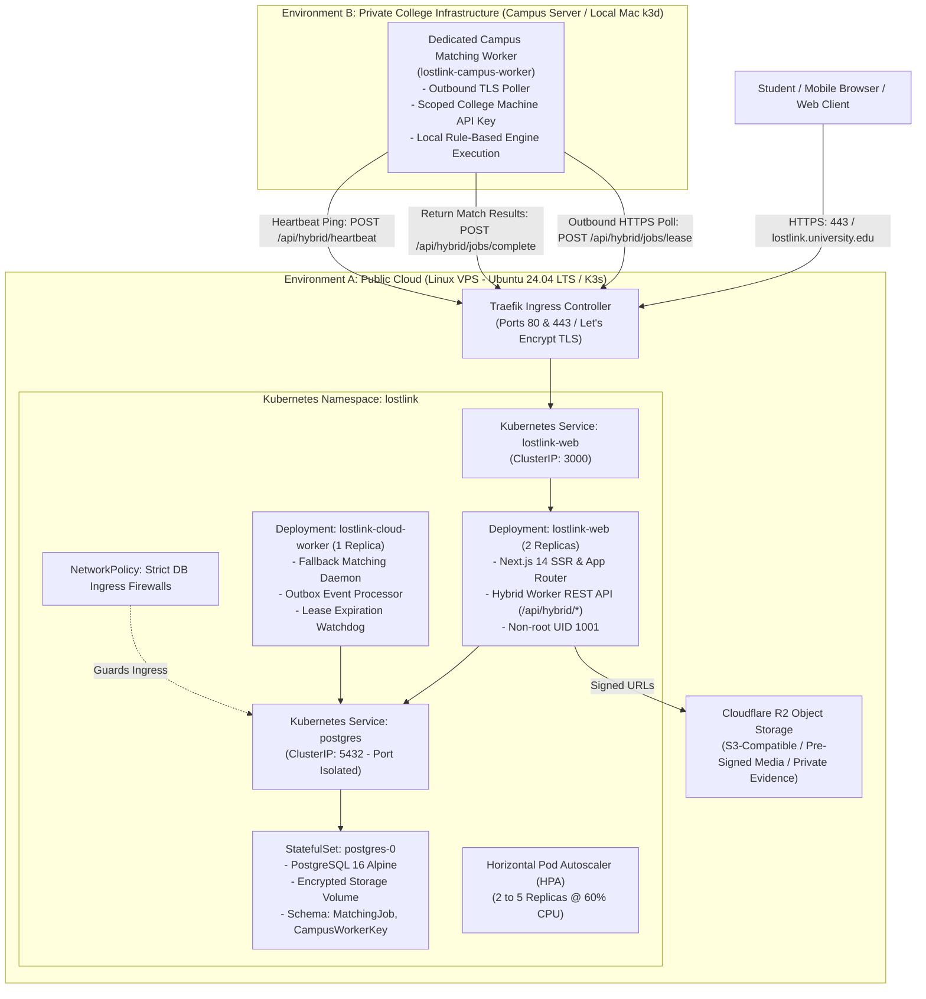

# LostLink 2.0 — Phase 5 Master Deployment & Hybrid-Cloud Architecture Plan

## 1. Project Context & Cloud Computing Module IV PBL Objective

**LostLink 2.0 — Smart Multi-College Lost & Found Platform** is an institutional SaaS recovery network enabling university students across multiple colleges to report lost and found belongings, discover potential matches via an explainable deterministic matching engine, file ownership claims, verify physical custody through time-bound cryptographic QR/OTP tokens, and securely coordinate handovers.

This project fulfills the Cloud Computing Module IV Project-Based Learning (PBL) curriculum:
> *"Build end-to-end cloud projects: design a scalable web app using containers/Kubernetes, deploy on hybrid cloud, and optimize costs."*

Phases 1 through 4 established:
- **Phase 1:** Complete Next.js 14 App Router frontend, Tailwind CSS design system, and multi-college UI.
- **Phase 2:** PostgreSQL 16 database, Prisma ORM, multi-tenant isolation, Argon2id auth, and object storage.
- **Phase 3:** Deterministic 100-point matching engine, escrow ownership claims, audit trails, and QR/OTP verification.
- **Phase 4:** Multi-stage Docker containers, local dual-node K3s cluster (`k3d`), Kustomize manifests, NetworkPolicies, non-root execution, HPA autoscaling (200 req/sec benchmarked), and automated backups.

**Phase 5 Objective:**  
Deploy LostLink 2.0 into a real public cloud environment connected to a separate, private college-side matching worker over an authenticated outbound HTTPS architecture, establishing a resilient hybrid-cloud topology with automatic cloud-fallback processing, zero-downtime rolling updates, and verifiable cost optimization.

---

## 2. Current State vs. Target Production State

| Architectural Dimension | Local Phase 4 State | Target Phase 5 Hybrid-Cloud State |
| :--- | :--- | :--- |
| **Hosting Platform** | Local Apple Silicon Mac (`k3d` dual-node cluster) | **Hybrid Cloud:** Public Linux VPS running K3s (`lostlink-public`) + Private College Node (`lostlink-campus` / local Mac k3d) |
| **Ingress & TLS** | Local Traefik on port `8080`, self-signed / HTTP | **Public Traefik + cert-manager** with Let's Encrypt automated TLS certificates on public domain / staging URL |
| **Network Exposure** | Host loopback (`127.0.0.1`, `localhost:8080`) | **Public Ports 80 & 443 only**. Postgres (5432) and K8s API (6443) strictly internal |
| **Matching Execution** | Single in-cluster worker polling `OutboxEvent` | **Distributed Hybrid Queue:** Dedicated Campus Worker leases jobs over authenticated outbound HTTPS; Public Cloud Fallback Worker handles failovers |
| **Failover Resilience** | Worker restart within same cluster | **Cross-Cloud Failover:** If campus worker drops, cloud fallback claims leased jobs after TTL expiration (30s) |
| **Data Storage** | Local-Path CSI 2Gi PersistentVolume | Production PostgreSQL StatefulSet / Managed PostgreSQL + Cloudflare R2 object storage |
| **Release Management** | Local script execution | **GitHub Actions CI/CD:** Staging deployment, approval gates, immutable image tags (SHA), automated rollbacks |
| **Monthly Cost** | \$0 (local laptop) | **Target: < \$25.00 / month (~₹2,100 INR)** for small collegiate pilot |

---

## 3. High-Level Hybrid-Cloud System Architecture

---

## 4. Logical & Operational Boundaries

1. **Zero Inbound Ports on Campus:** The college network requires **NO open ports**, no port forwarding, and no publicly exposed IPs. The campus worker operates exclusively via **outbound HTTPS connections** to the public API.
2. **Data Minimization:** Matching jobs delivered to the campus worker contain **only non-sensitive public metadata** (item title, category, description, campus location, color, brand/model). Private student ownership evidence is **never sent to external workers**.
3. **Lease-Based Job Coordination:** Jobs are leased with a strict Time-to-Live (TTL: 30 seconds). If a campus worker disconnects or crashes mid-computation, the lease automatically expires, allowing the cloud fallback worker to claim the job without data loss.
4. **Idempotency & Double-Execution Guard:** Job completion requires a conditional atomic update verifying the job status is still `LEASED` and assigned to that specific `workerId`. Double completions are rejected at the database level.
5. **No Direct Database Exposure:** The PostgreSQL database is never exposed on the public internet. Access is restricted strictly to pods within the public Kubernetes cluster via Kubernetes `NetworkPolicy`.

---

## 5. Deployment Milestones & Phased Roadmap

| Milestone | Phase Focus | Key Deliverables | Verification Gateway |
| :--- | :--- | :--- | :--- |
| **M1** | **Audit & Schema Expansion** | Create `PHASE5_DEPLOYMENT_PLAN.md`, add `MatchingJob` and `CampusWorkerKey` Prisma models, generate migrations. | Zero regressions on existing 54 tests; migration applies cleanly. |
| **M2** | **Hybrid Worker API & Engine** | Implement `/api/hybrid/jobs/lease`, `/api/hybrid/jobs/complete`, `/api/hybrid/heartbeat`, and `/api/hybrid/keys`. | Unit & integration tests for lease, concurrency, and authorization. |
| **M3** | **Campus Worker Daemon** | Implement `worker/campusWorker.ts` with outbound HTTPS client, backoff retries, and local matching execution. | End-to-end execution leasing a job from local API. |
| **M4** | **Cloud Fallback & Failover** | Implement lease expiration sweeper and cloud fallback worker; build automated failover test script. | Simulated campus disconnection triggers cloud fallback in < 35s. |
| **M5** | **Public Cloud Infrastructure** | Compare VPS providers, write K3s installation scripts, UFW firewall configurations, and cert-manager manifests. | Complete declarative infrastructure-as-code ready for public deployment. |
| **M6** | **K8s Environment Overlays** | Create `k8s/overlays/staging/`, `k8s/overlays/production/`, and `k8s/overlays/campus/`. | `kubectl kustomize` renders valid manifests for all tiers. |
| **M7** | **CI/CD Pipeline Upgrades** | Create `.github/workflows/staging-deploy.yml` and `production-deploy.yml` with approvals and rollbacks. | Workflow syntax validation; dry-run pipeline test. |
| **M8** | **Cost & Benchmark Analysis** | Compile `docs/PHASE5_COST_ANALYSIS.md` (USD & INR) and benchmark hybrid vs. cloud execution metrics. | Empirical measurements documented in graphs and tables. |
| **M9** | **PBL Demonstration & Viva Pack** | Produce `docs/PBL_DEMONSTRATION_GUIDE.md` with 25 beginner-friendly viva questions and answers. | Complete documentation ready for academic evaluation. |

---

## 6. Required Accounts & Credentials

| Service / Resource | Purpose | Production Requirement | Dev/Staging Fallback |
| :--- | :--- | :--- | :--- |
| **Public Linux VPS** | Public Kubernetes Node | Ubuntu 24.04 LTS (2 vCPU, 4GB RAM, SSD) | Local Mac `k3d` simulation cluster |
| **DNS Domain Name** | Public Routing & SSL | Subdomain with A/AAAA records pointing to VPS IP | `sslip.io` / `nip.io` wildcard DNS or staging IP |
| **Let's Encrypt / ACME** | Automated TLS Certificates | Valid email for Let's Encrypt certificate notices | Traefik self-signed / staging ACME directory |
| **Cloudflare R2 / S3** | Cloud Object Storage | Account ID, Access Key ID, Secret Access Key | Local filesystem storage (`STORAGE_DRIVER=local`) |
| **SMTP / Email Delivery**| Student Notification Emails | Resend / SendGrid / Postmark / SMTP credentials | Mailpit local catcher (`axllent/mailpit`) |
| **GitHub Container Reg**| Container Image Storage | `ghcr.io` access via `GITHUB_TOKEN` | Local Docker daemon cache |

---

## 7. Acceptance Criteria for Phase 5 Completion

1. [x] Git checkpoint created on branch `phase-5-hybrid-cloud`.
2. [ ] Database schema updated with `MatchingJob` (lifecycle states) and `CampusWorkerKey` (machine auth).
3. [ ] Authenticated REST API implemented for hybrid worker communication with college scoping.
4. [ ] Standalone campus matching worker daemon (`worker/campusWorker.ts`) built and operational.
5. [ ] Cloud fallback worker daemon implemented with lease recovery watchdog.
6. [ ] Automated hybrid failover test script (`scripts/test-hybrid-failover.sh`) demonstrates zero lost jobs and seamless failover.
7. [ ] Declarative Kubernetes overlays for Staging, Production, and Campus environments created.
8. [ ] Complete public cloud provisioning and hardening scripts written for Ubuntu 24.04 LTS VPS.
9. [ ] CI/CD GitHub Actions workflows for continuous deployment and rollback implemented.
10. [ ] Comprehensive cost optimization analysis documented in both USD and INR.
11. [ ] Complete PBL demonstration guide with 25 beginner-friendly viva questions and answers produced.
12. [ ] All existing 54 tests pass with 100% success rate.

