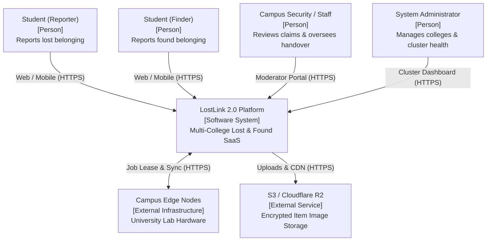
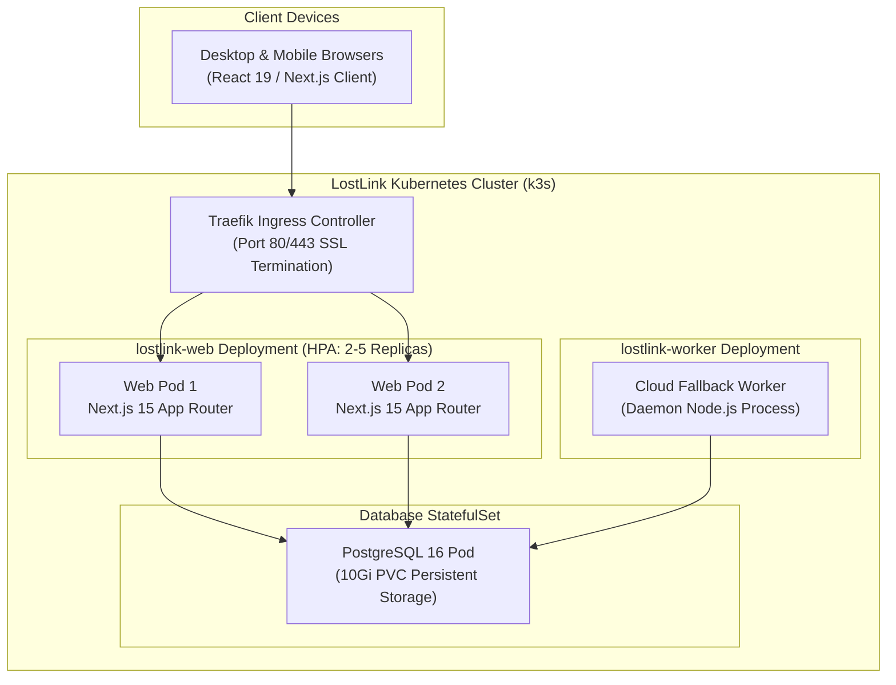
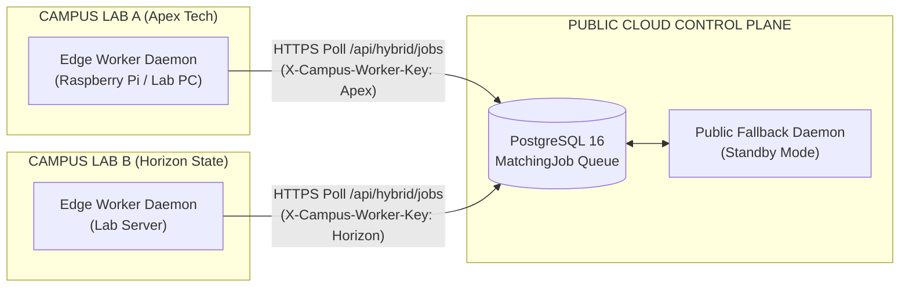
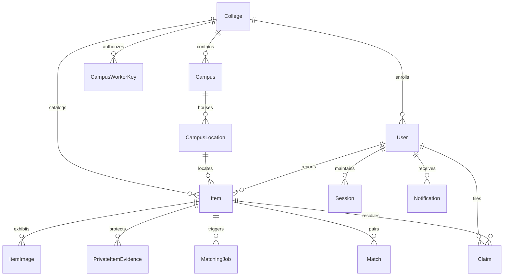
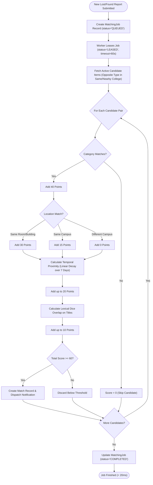
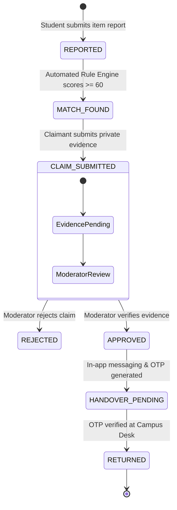
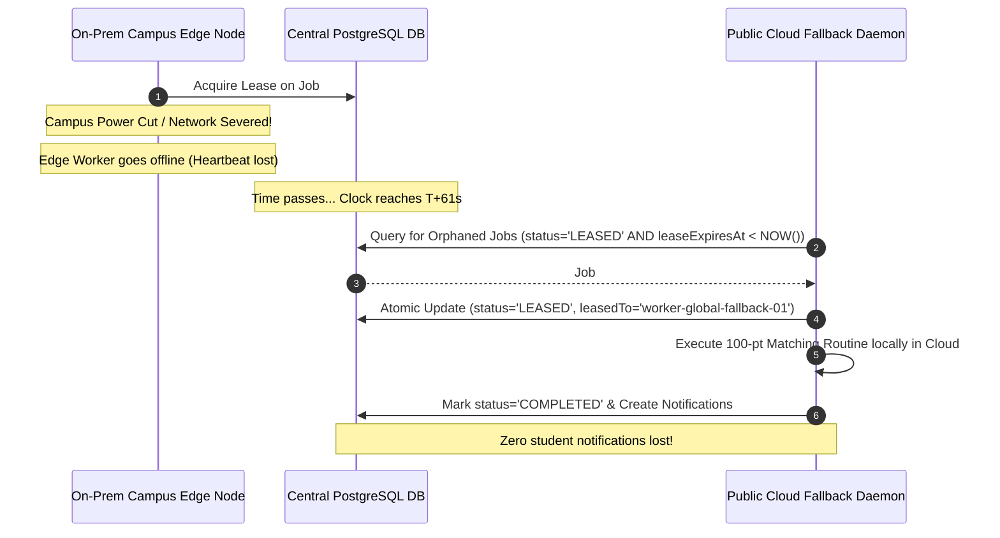
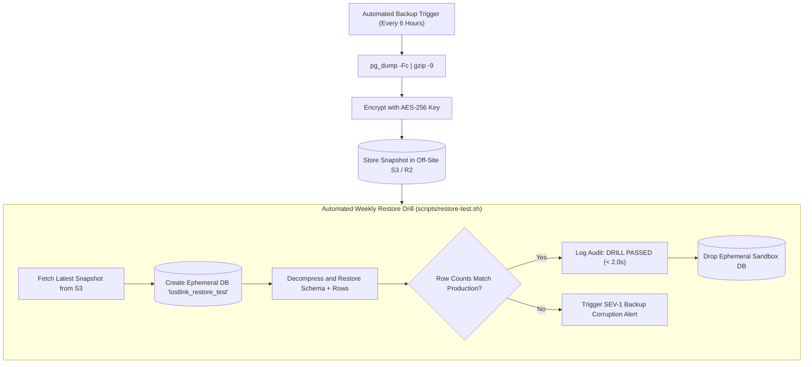

# LOSTLINK 2.0 — COMPLETE ARCHITECTURE DIAGRAMS & FLOWCHARTS
## Comprehensive Technical Visualizations in Mermaid & ASCII for Academic Submission

---

### DIAGRAM 1: SYSTEM CONTEXT DIAGRAM (C4 LEVEL 1)



---

### DIAGRAM 2: CONTAINER & CLUSTER ARCHITECTURE (C4 LEVEL 2)



---

### DIAGRAM 3: KUBERNETES PHYSICAL TOPOLOGY & TRAFFIC ROUTING

```
           +-------------------------------------------------------------+
           |                INTERNET (Student Web Traffic)               |
           +-------------------------------------------------------------+
                                          |
                                          v Port 80/443 (HTTP/HTTPS)
           +-------------------------------------------------------------+
           |           TRAEFIK INGRESS CONTROLLER (K3S HOST)             |
           |   - Path: /api/*  -> Route to Next.js API Handlers           |
           |   - Path: /*      -> Route to Next.js SSR / Static Pages    |
           +-------------------------------------------------------------+
                                          |
                    +---------------------+---------------------+
                    |                                           |
                    v                                           v
     +------------------------------+            +------------------------------+
     |   POD: lostlink-web-pod-1    |            |   POD: lostlink-web-pod-2    |
     |   IP: 10.42.0.12 (Port 3000) |            |   IP: 10.42.0.14 (Port 3000) |
     |   - UID: 1001 (nextjs)       |            |   - UID: 1001 (nextjs)       |
     |   - Limits: 500m CPU, 512Mi  |            |   - Limits: 500m CPU, 512Mi  |
     +------------------------------+            +------------------------------+
                    |                                           |
                    +---------------------+---------------------+
                                          |
                                          v Port 5432 (Internal Cluster Network)
                            +-----------------------------+
                            |     SERVICE: postgres       |
                            |   ClusterIP: 10.43.155.220  |
                            +-----------------------------+
                                          |
                                          v
                            +-----------------------------+
                            |     POD: postgres-0         |
                            |   PostgreSQL 16 Engine      |
                            |   Mount: /var/lib/data      |
                            |   PVC: 10Gi SSD Block Store |
                            +-----------------------------+
```

---

### DIAGRAM 4: HYBRID-CLOUD WORKER PARTITIONING TOPOLOGY



---

### DIAGRAM 5: MULTI-TENANT DATABASE ENTITY-RELATIONSHIP DIAGRAM



---

### DIAGRAM 6: DETERMINISTIC 100-POINT MATCHING ENGINE FLOWCHART



---

### DIAGRAM 7: END-TO-END ITEM RECOVERY STATE MACHINE



---

### DIAGRAM 8: ZERO-TRUST OWNERSHIP VERIFICATION & BLIND EVIDENCE DATA FLOW

```
[CLAIMANT STUDENT]
  |
  | 1. Enters Private Evidence (Serial Number, Engraving, Lock Screen Photo)
  v
+---------------------------------------------------------------------------------+
| CLIENT BROWSER: Form Submission (HTTPS POST /api/claims)                        |
+---------------------------------------------------------------------------------+
  |
  | 2. Encrypted Evidence Payload
  v
+---------------------------------------------------------------------------------+
| SERVER API ROUTE: Session & Ownership Auth Check                                |
+---------------------------------------------------------------------------------+
  |
  | 3. Stores in PrivateItemEvidence table (HIDDEN FROM PUBLIC SEARCH)
  v
+---------------------------------------------------------------------------------+
| CENTRAL DATABASE: Item & Claim Record Created                                   |
+---------------------------------------------------------------------------------+
  |
  | 4. Notification sent to College Moderator
  v
+---------------------------------------------------------------------------------+
| MODERATOR PORTAL: Moderator views Blind Evidence vs Physical Item at Desk       |
| - If Match: One-click "APPROVE CLAIM"                                           |
| - If Mismatch: "REJECT CLAIM" with feedback                                     |
+---------------------------------------------------------------------------------+
```

---

### DIAGRAM 9: HYBRID FAILOVER & LEASE RECLAMATION SEQUENCE



---

### DIAGRAM 10: CI/CD PIPELINE FLOWCHART

```mermaid
flowchart LR
    Push(["Developer Git Push"]) --> Lint["Lint & Static Analysis"]
    Lint --> Typecheck["TypeScript Compiler (0 Errors)"]
    Typecheck --> SecurityTest["OWASP ASVS 5.0 Security Suite (11 Tests)"]
    SecurityTest --> UnitTests["Prisma & Business Logic Tests (60 Tests)"]
    UnitTests --> DockerBuild["Multi-Stage Docker Build (Next.js Standalone)"]
    DockerBuild --> K3dDeploy["Deploy to Kubernetes Cluster (k8s-deploy.sh)"]
    K3dDeploy --> K6Bench["Execute k6 Load Test Suite (100 VUs)"]
    K6Bench --> ProdReady(["Release: CONTROLLED PILOT READY"])
```



---

### DIAGRAM 11: DISASTER RECOVERY & INTEGRITY DRILL FLOW



---

### DIAGRAM 12: GRAFANA K6 LOAD TESTING WORKLOAD PROGRESSION CURVE

```
Virtual Users (VUs)
   100 |                                       +--------------------+
       |                                      /                      \
    50 |                         +-----------+                        \
       |                        /                                      \
    25 |             +---------+                                        \
       |            /                                                    \
     5 |  +--------+                                                      +
       +---------------------------------------------------------------------> Time (s)
          0s        10s        30s         60s          80s           90s
       [Warm-up] [Ramp-up] [Peak Burst] [Stress Spike] [Recovery] [Cool-down]
```
